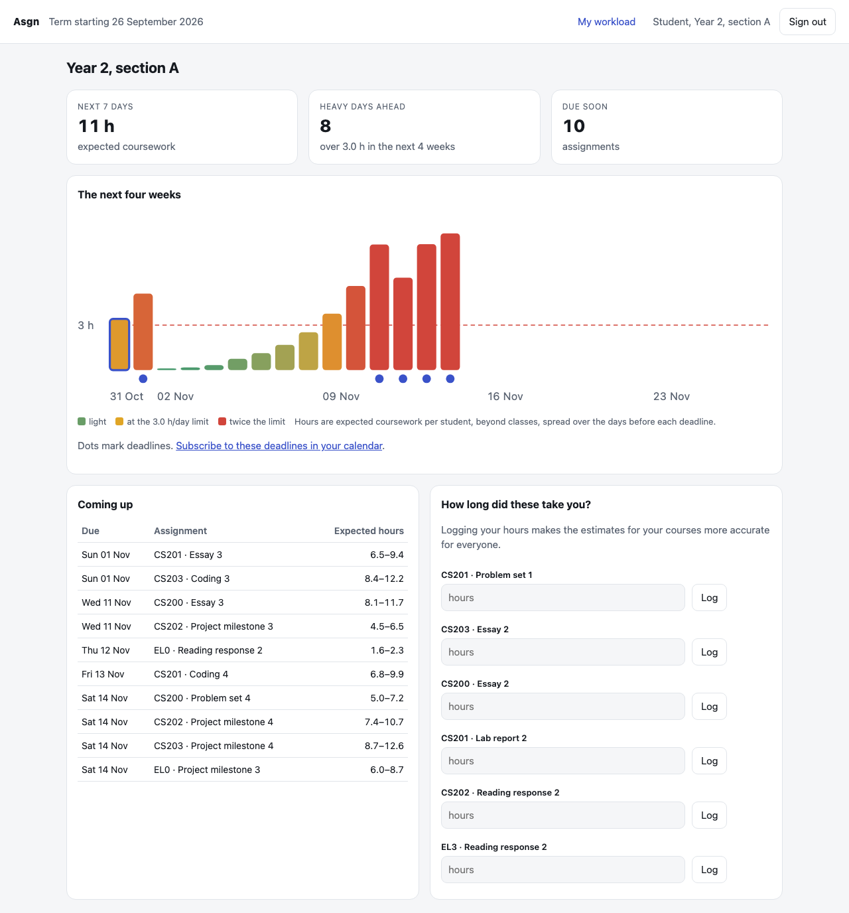
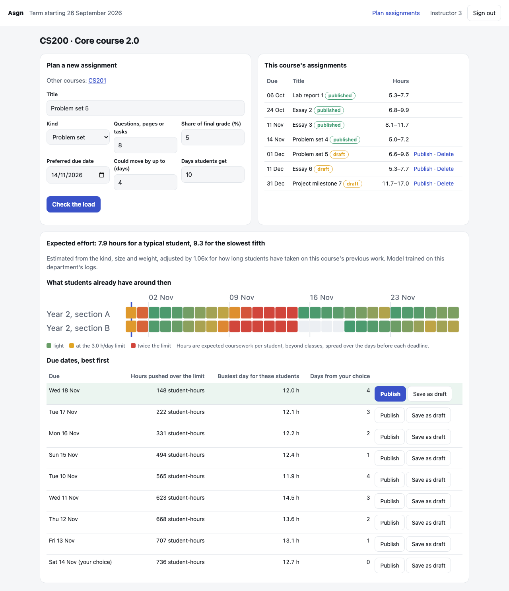
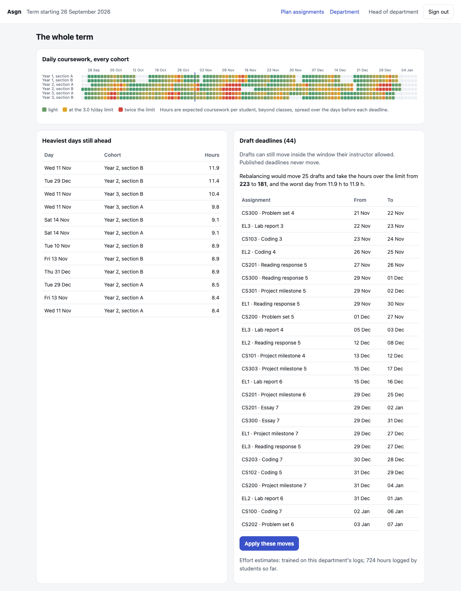

# Asgn

**Every course sets its own deadlines; nobody sees that they all land on the same
week. Asgn shows each group of students the coursework building up across all their
courses, tells instructors which due date would add the least to an overloaded week,
and lets a department rebalance the term in one click.**

| Students | Instructors | Department |
|---|---|---|
|  |  |  |

## What it does

- **Estimates effort.** From what an instructor knows when setting the work (kind, size,
  grade weight, course level, days given), a quantile gradient-boosting model predicts the
  hours a typical student will need and the hours for the slowest fifth. As students log the
  time they actually spent, each course's estimates are recalibrated.
- **Shows the load.** Effort is spread over the days before each deadline, leaning towards
  the deadline the way students actually work, and summed across every course a cohort
  takes. Students see their next four weeks; the department sees every cohort for the whole
  term; days over the limit (3 hours of coursework per day beyond classes, configurable)
  stand out.
- **Advises on deadlines.** An instructor enters their preferred date and how far it could
  move; every allowed date is ranked by how many student-hours it would push over the
  limit, then by the busiest day it would create.
- **Rebalances the term.** Draft deadlines can be re-planned together inside each
  instructor's window; published deadlines never move. A local search does this in a third
  of a second and matches an exact integer program run for a minute.
- **Calendar feed.** Each cohort gets an iCalendar link with every published deadline and
  its expected hours.

## Results

On 10 synthetic terms ([docs/study.md](docs/study.md)):

| | Instructors choose alone | With Asgn's planner |
|---|---:|---:|
| Hours over the daily limit, all cohorts | 171 | **56** (−67 %) |
| Worst day for any cohort | 10.3 h | **6.6 h** |
| Average move of a deadline | | 1.9 days |

Even without central planning, instructors who each take the advisor's suggestion cut the
overload by 59 %. Effort estimates calibrated on each course's logged time are off by a
factor of 1.22 in a typical case, against 1.33 for a per-kind average.

## Run it

Needs Python 3.12 and [uv](https://docs.astral.sh/uv/).

```bash
uv sync
uv run asgn demo
```

`asgn demo` creates a department five weeks into a term (six cohorts, 16 courses, logged
time on past work) and prints sign-ins for a student in each cohort, each instructor and the
head of department. Everything in it is synthetic.

```bash
uv run asgn serve --db asgn.db --secure     # behind HTTPS, against your own database
uv run asgn study --seeds 10                # the study behind docs/study.md
make check                                  # ruff, mypy --strict, pytest
```

## Repository

```
src/asgn/
  load.py       how work spreads over days; daily load per cohort
  effort.py     effort model, per-course calibration, synthetic logs, evaluation
  schedule.py   deadline advisor, local-search planner, exact integer program (HiGHS)
  sim.py        synthetic terms and the policy comparison
  store.py      SQLite: term, cohorts, courses, people, assignments, time logs, sessions
  service.py    what the web app computes
  web.py        FastAPI routes; templates/ and static/ hold the pages
  charts.py     server-rendered SVG heatmaps and bar charts
  cli.py        demo, serve, study
results/        study results (JSON)
docs/           the study
```

## History

Asgn began during my time as a Research and Development Associate with the IEEE Student
Branch at SRM Institute of Science and Technology, as an experiment in whether a regression
model could spread assignments evenly across courses. It grew into a tool for tracking
workload and making it visible. My conclusion from that work: the model was the easy part;
the gap was that nobody could see the workload building up.

This repository is a ground-up rewrite (2026) around that conclusion. Visibility comes
first, for students, instructors and the department; the prediction and the planning
serve it, and both are measured.
